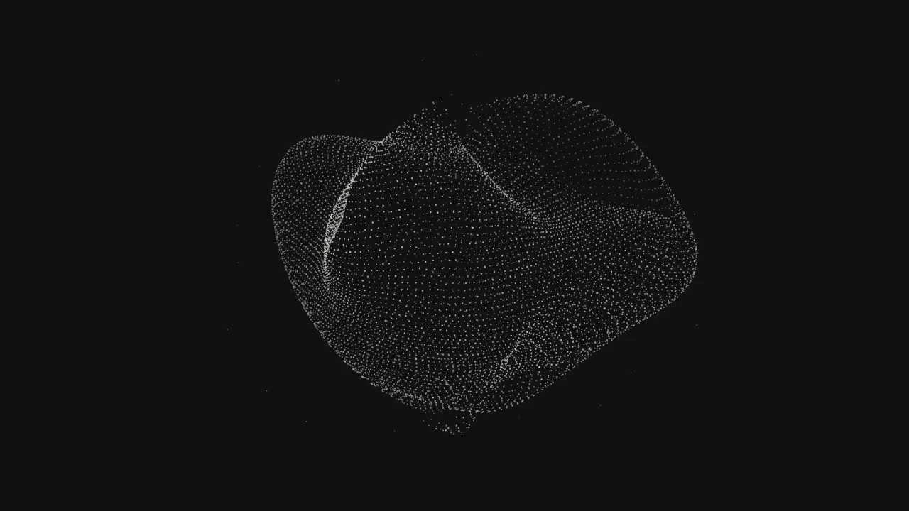

# Particle Breath by Limot

A soft, folded volume of thousands of particles that gently breathes in place. A small, deterministic **Canvas animated background** with zero runtime dependencies, made by **[Limot](https://limot.dev)**.

**Website: [limot.dev](https://limot.dev)** · [Interactive editor](https://limot.dev/effects/particle-breath/) · [Source](https://github.com/bimohxh/limot-particle-breath)



## Why Particle Breath?

- Organic, asymmetric particle geometry with local breathing waves and subtle depth.
- Stable surface samples: no random reshuffling between frames.
- Adjustable density, speed, scale, colors, particle size, breathing strength, and graphic opacity.
- Responsive canvas sizing, retina rendering up to 2× DPR, and explicit cleanup.
- Plain JavaScript ES module with TypeScript declarations. Works with React, Vue, and browser module scripts.
- MIT licensed for personal and commercial use.

This is the standalone open-source edition of Particle Breath from [Limot's animated background library](https://limot.dev). It preserves the original effect's geometry, parameter ranges, and default appearance.

## Install

```sh
npm install limot-particle-breath
```

## JavaScript

Give the container an explicit height. Keep the canvas decorative when your page already provides equivalent context.

```html
<div style="height: 480px; overflow: hidden">
  <canvas id="breath" aria-hidden="true" style="display: block; width: 100%; height: 100%"></canvas>
</div>
```

```js
import { mountParticleBreath } from 'limot-particle-breath';

const stop = mountParticleBreath(document.querySelector('#breath'), {
  backgroundColor: '#111111',
  dotColor: '#e0dfd8',
  speed: 1,
});

// Call when removing the canvas or leaving the page:
// stop();
```

For live controls, pass a configuration provider. Its return value is read on each frame; changing colors does not re-scatter particles.

```js
const config = { speed: 1, breathStrength: 75 };
const stop = mountParticleBreath(canvas, () => config);
config.speed = 0.5;
```

## Browser without a bundler

Use the same markup above with a module script:

```html
<script type="module">
  import { mountParticleBreath } from 'https://cdn.jsdelivr.net/npm/limot-particle-breath@1.0.0/src/index.js';
  mountParticleBreath(document.querySelector('#breath'));
</script>
```

## React / Next.js

```jsx
'use client';

import { useEffect, useRef } from 'react';
import { mountParticleBreath } from 'limot-particle-breath';

export function ParticleBreath({ speed = 1 }) {
  const canvas = useRef(null);
  const config = useRef({ speed });
  config.current = { speed };

  useEffect(() => mountParticleBreath(canvas.current, () => config.current), []);

  return (
    <div style={{ height: 480, overflow: 'hidden' }}>
      <canvas ref={canvas} aria-hidden="true"
        style={{ display: 'block', width: '100%', height: '100%' }} />
    </div>
  );
}
```

The module is safe to import during server rendering. Mount it only after the canvas exists in the browser. The effect cleanup also works with React Strict Mode.

## Vue 3

```vue
<script setup>
import { ref, onMounted, onBeforeUnmount } from 'vue';
import { mountParticleBreath } from 'limot-particle-breath';

const canvas = ref(null);
let stop;
onMounted(() => { stop = mountParticleBreath(canvas.value); });
onBeforeUnmount(() => { stop?.(); });
</script>

<template>
  <div style="height: 480px; overflow: hidden">
    <canvas ref="canvas" aria-hidden="true" style="display: block; width: 100%; height: 100%" />
  </div>
</template>
```

## Options

| Option | Default | Range / meaning |
| --- | --- | --- |
| `backgroundColor` | `#111111` | Opaque CSS background color |
| `dotColor` | `#e0dfd8` | CSS particle color |
| `scale` | `100` | 40–125, percent |
| `particleSize` | `1` | 0.5–2, logical pixels |
| `particleCount` | `8500` | 1500–16000, approximate surface sample density |
| `opacity` | `1` | 0–1, complete particle layer; background remains opaque |
| `speed` | `1` | 0–3; zero renders the resting pose |
| `breathStrength` | `75` | 0–150, percent |

All options are optional. Out-of-range numbers are clamped; non-finite values fall back to defaults. Particle density is approximate because samples follow latitude rows. Changing density rebuilds the stable sample set; other controls retain it.

For a light background, use `{ backgroundColor: '#f4f3ef', dotColor: '#252525' }`.

For reduced-motion preferences, pass `speed: 0` when `matchMedia('(prefers-reduced-motion: reduce)').matches` is true. The library does not install page-level preference listeners for you.

## Deterministic frame rendering

```js
import { drawParticleBreath } from 'limot-particle-breath';

const ctx = canvas.getContext('2d');
drawParticleBreath(ctx, canvas.width, canvas.height, 2.5, { speed: 1 });
```

The fourth argument is elapsed seconds. Rendering the same configuration and timestamp produces the same frame in a given canvas implementation. Use `frame / 30` for a deterministic 30 FPS export timeline; video encoding is left to your application. When drawing in logical pixels on a retina canvas, set the context transform before calling this function. The function restores context state afterward and caches samples per context.

`createBreathParticles(count)` and `breathPoint(particle, time, amplitude)` are also exported for custom renderers. The low-level amplitude is normalized (`1` corresponds to the default `breathStrength: 75`). Keep direct sampler counts within the documented range.

## Run the demo / contribute

```sh
git clone https://github.com/bimohxh/limot-particle-breath.git
cd limot-particle-breath
npm ci
npm test
npm run dev
```

Open `http://localhost:4173`. The demo runs local source, with no CDN or account required. Runtime code requires a modern browser with Canvas 2D, ES modules, and ResizeObserver. Development and tests use Node.js 22 or newer.

## More animated backgrounds

Explore **[Limot — animated backgrounds for websites](https://limot.dev)** to adjust effects visually and export reusable assets and code. This package includes Particle Breath only; the Limot catalog has separate access terms.

中文：Particle Breath（呼吸粒子）是 [Limot 网页动态背景库](https://limot.dev) 的独立开源效果，支持 JavaScript、React 和 Vue，可用于个人及商业项目。

## License

[MIT](./LICENSE) © 2026 [Limot](https://limot.dev).
